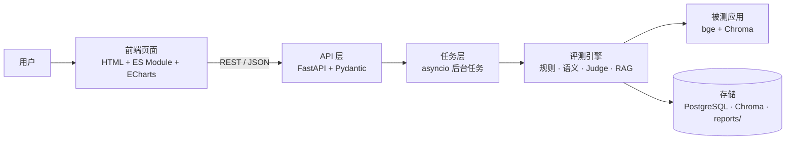

# AI 问答评测平台

面向 RAG 问答应用的评测平台：四层指标（规则 / 语义 / Judge / RAG 分段）+ 并发执行引擎 + 结果分析 + 自包含 HTML 报告。

## 能力概览

| 层 | 能力 |
|----|------|
| 规则 | 8 类确定性检查（非空/长度/关键词/禁用词/JSON/正则/安全/引用）+ 4 种期望行为断言 |
| 语义 | bge-small-zh 相似度、批量编码、阈值可校准（当前 0.84，F1 0.862） |
| Judge | 0-5 分 rubric、忠实度原子论断核查、4 类偏差控制 |
| 检索 | Context Precision / Recall / Faithfulness / Answer Relevance + 4 象限归因 |
| 执行 | asyncio 并发、指数退避重试、MD5 缓存、断点续跑 |
| 分析 | 按类别分组、badcase 聚类、版本 diff（3 个点噪声阈值） |
| 呈现 | 结论优先的自包含 HTML 报告 |

## 快速开始

```powershell
$env:HF_ENDPOINT="https://hf-mirror.com"
$env:ANONYMIZED_TELEMETRY="False"

# 1. 三类数据集基线
python scripts\run_baseline.py --dataset golden
python scripts\run_baseline.py --dataset adversarial
python scripts\run_baseline.py --dataset edge

# 2. 结果分析 + HTML 报告
python scripts\run_analysis.py
python scripts\generate_report.py

# 3. 测试
python -m pytest tests -q

# 4. 启动平台（前端静态页由后端托管）
python -m uvicorn backend.main:app --port 8000
# 打开 http://localhost:8000/
```

产物：`reports/baseline_*_v1.json`、`reports/analysis_golden_v1.json`、`reports/report_v1.html`。

> 未配置 `LLM_API_KEY` 时，Judge 与生成自动降级为规则实现，报告会标注「mock 基线」。

## 架构



数据链路：数据集 → 用例 → 评测任务 → 用例结果 → 指标快照 → 聚合报告。

完整设计见 [docs/day15-architecture.md](docs/day15-architecture.md)（实体 / ER / 13 个 API 契约 / Schema / 分层与时序图），建表语句见 [sql/schema.sql](sql/schema.sql)。

## 目录

```
app/            被测 RAG 应用（retrieve / generate / ask）
evaluation/     四层评测器
engine/         执行引擎（并发/重试/缓存/断点）
analysis/       分组统计 / badcase 聚类 / 版本对比
backend/        平台后端（FastAPI 接口 + 异步任务）
frontend/       平台前端（概览看板 / 数据集 / 发起评测 / 任务 / 结果页）
eval_datasets/  黄金集 55 · 对抗集 25 · 边界集 17 · 校准集 50
scripts/        基线、校准、分析、报告、性能实验
templates/      HTML 报告模板
sql/            数据库 Schema
docs/           每日设计与实验记录
tests/          64 条测试
```

## 文档

- 架构设计：`docs/day15-architecture.md`
- 平台后端：`docs/day16-backend-api.md`、`docs/day17-async-tasks.md`
- 平台前端：`docs/day18-frontend.md`、`docs/day19-dashboard.md`
- 评测体系：`docs/day6-evaluation-framework.md`、`docs/day11-rag-evaluator.md`
- 执行引擎：`docs/day12-eval-engine.md`
- 分析与报告：`docs/day13-analysis.md`、`docs/day14-html-report.md`
- 周总结：`reports/week2_summary.html`
