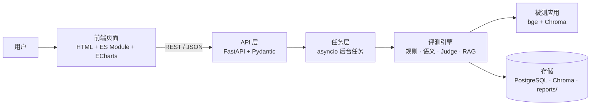

# AI 问答评测平台

面向 RAG 问答应用的评测平台：四层指标（规则 / 语义 / Judge / RAG 分段）+ 并发执行引擎 + 结果分析 + 自包含 HTML 报告。

## 能力概览

| 层 | 能力 |
|----|------|
| 规则 | 8 类确定性检查（非空/长度/关键词/禁用词/JSON/正则/安全/引用）+ 4 种期望行为断言 |
| 语义 | bge-small-zh 相似度、批量编码、阈值可校准（当前 0.84，F1 0.862） |
| Judge | 0-5 分 rubric、忠实度原子论断核查、4 类偏差控制 |
| 检索 | Context Precision / Recall / Faithfulness / Answer Relevance + 4 象限归因 |
| 执行 | asyncio 并发、指数退避重试、MD5 缓存、断点续跑 |
| 分析 | 按类别分组、badcase 聚类、版本 diff（3 个点噪声阈值） |
| 门禁 | 6 条质量规则 + 安全一票否决 + 基线对比，PR / 每日 / 发布三级触发 |
| 灰度 | 逐用例 Prompt 差异、按 user_id 稳定分流、5 项指标自动回滚 |
| 呈现 | 结论优先的自包含 HTML 报告 |

## 快速开始

### 方式一：Docker 一键启动（推荐）

```bash
cp .env.example .env        # LLM_API_KEY 可留空，评测自动走 mock 降级
docker compose up -d --build
docker compose exec api python scripts/import_dataset.py eval_datasets/golden_set.json
```

打开 `http://localhost`（API 文档 `http://localhost:8000/docs`）。首次构建会下载依赖与 embedding 模型，之后重建复用 `model-cache` 卷。

### 方式二：本地开发（SQLite 零配置）

```powershell
$env:HF_ENDPOINT="https://hf-mirror.com"
$env:ANONYMIZED_TELEMETRY="False"

# 1. 三类数据集基线
python scripts\run_baseline.py --dataset golden
python scripts\run_baseline.py --dataset adversarial
python scripts\run_baseline.py --dataset edge

# 2. 结果分析 + HTML 报告
python scripts\run_analysis.py
python scripts\generate_report.py

# 3. 测试
python -m pytest tests -q

# 4. 启动平台（前端静态页由后端托管）
python -m uvicorn backend.main:app --port 8000
# 打开 http://localhost:8000/
```

产物：`reports/baseline_*_v1.json`、`reports/analysis_golden_v1.json`、`reports/report_v1.html`。

> 未配置 `LLM_API_KEY` 时，Judge 与生成自动降级为规则实现，报告会标注「mock 基线」。

## 功能

| 页面 | 能力 |
|------|------|
| 质量概览 | 最近总分/等级、通过率、Badcase 数；能力雷达、版本趋势、分类通过率、版本对比四张图 |
| 数据集 | 列表、用例分页预览、新建数据集、JSON 上传（重复 ID 自动跳过） |
| 发起评测 | 数据集 / Prompt 版本 / 模型选择，后台执行 + 进度条 + 取消 |
| 任务列表 | 状态、进度、总分、耗时，未完成任务自动刷新 |
| 结果详情 | 指标卡片、与上次评测对比、Badcase 展开对照标准答案、JSON/HTML 报告导出 |
| 线上监控 | 24h 抽样均分/差评率、问题分布、30 天趋势、业务线明细、badcase 回流进度 |

## 质量门禁

Prompt / 应用 / 评测集变更时自动跑评测，不达标阻断合并：

```powershell
# 跑 20 条冒烟集并生成门禁报告
python scripts\run_eval.py --dataset golden --limit 20 --output reports\gate-result.json

# 门禁检查（第二个参数是基线，可选），失败会输出具体差距并返回 exit 1
python scripts\quality_gate.py reports\gate-result.json baselines\latest.json `
  --comment reports\gate-comment.md

# 用历史报告复核阈值是否合理
python scripts\derive_thresholds.py --write baselines\thresholds.json
```

CI 配置见 `.github/workflows/`：`ai-quality-gate.yml`（PR 阻断）、`daily-regression.yml`（每日告警）、`release-gate.yml`（发布阻断）。设计说明见 [docs/day22-quality-gate.md](docs/day22-quality-gate.md)。

## Prompt 回归与灰度

门禁回答「能不能进」，差异分析回答「具体改好了哪些、改坏了哪些」：

```powershell
# 逐用例对比两个版本（输入可以是 run_eval 报告或平台结果 JSON）
python scripts\prompt_diff.py baselines\latest.json reports\candidate.json `
  --label-baseline v1.2.0 --label-current v1.3.0 `
  --json reports\prompt-diff.json --markdown reports\prompt-diff.md
```

- `analysis/prompt_diff.py`：improved / degraded / unchanged + 分类归因 + 均值掩盖提示
- `app/ab_router.py`：按 user_id 的 MD5 分桶稳定灰度（默认 5%）
- `app/gray_guard.py`：在线分数、负反馈率、拒答率、P95 延迟、Token 成本 5 项指标，越线返回回滚建议

完整流程与灰度监控口径见 [docs/day23-prompt-regression.md](docs/day23-prompt-regression.md)。

## 线上监控与 badcase 回流

真实流量按 2% 抽样评测，用户差评自动归入 5 类问题，待标注用例人工补标准答案后才进入回归：

```powershell
# 收集近 7 天差评，同类问题至少出现 3 次才回流
python scripts\reflow_badcases.py --days 7 --min-count 3

# 人工确认：补 ground_truth 后转 verified=true
python scripts\reflow_badcases.py --verify fresh_ab12cd34 --ground-truth "标准答案"

# 查看回流进度
python scripts\reflow_badcases.py --stats
```

看板入口 `/pages/monitor.html`；接口 `POST /api/feedback`、`POST /api/monitor/samples`、`GET /api/monitor/overview`。设计说明见 [docs/day24-online-monitoring.md](docs/day24-online-monitoring.md)。

## 架构



数据链路：数据集 → 用例 → 评测任务 → 用例结果 → 指标快照 → 聚合报告。

完整设计见 [docs/day15-architecture.md](docs/day15-architecture.md)（实体 / ER / 13 个 API 契约 / Schema / 分层与时序图），建表语句见 [sql/schema.sql](sql/schema.sql)。

## 目录

```
app/            被测 RAG 应用（retrieve / generate / ask）
evaluation/     四层评测器
engine/         执行引擎（并发/重试/缓存/断点）
analysis/       分组统计 / badcase 聚类 / 版本对比
backend/        平台后端（FastAPI 接口 + 异步任务）
monitor/        线上抽样 / 反馈归类 / badcase 回流
frontend/       平台前端（概览看板 / 数据集 / 发起评测 / 任务 / 结果页 / 线上监控）
eval_datasets/  黄金集 55 · 对抗集 25 · 边界集 17 · 校准集 50
scripts/        基线、校准、分析、报告、性能实验
templates/      HTML 报告模板
sql/            数据库 Schema
docs/           每日设计与实验记录
tests/          112 条测试
```

## 文档

- 架构设计：`docs/day15-architecture.md`
- 平台后端：`docs/day16-backend-api.md`、`docs/day17-async-tasks.md`
- 平台前端：`docs/day18-frontend.md`、`docs/day19-dashboard.md`
- 联调部署：`docs/day20-21-deploy.md`
- 质量门禁：`docs/day22-quality-gate.md`
- Prompt 回归与灰度：`docs/day23-prompt-regression.md`
- 线上监控与回流：`docs/day24-online-monitoring.md`
- 评测体系：`docs/day6-evaluation-framework.md`、`docs/day11-rag-evaluator.md`
- 执行引擎：`docs/day12-eval-engine.md`
- 分析与报告：`docs/day13-analysis.md`、`docs/day14-html-report.md`
- 周总结：`reports/week2_summary.html`

## 常见问题

| 现象 | 原因与处理 |
|------|-----------|
| `docker compose up` 后 api 反复重启 | 通常是数据库未就绪或依赖未装全；看 `docker compose logs api`，确认 db 健康检查通过 |
| 页面能开但接口 404/跨域 | 生产走 Nginx 同源代理，不跨域；本地直连 8000 端口，跨域已在后端允许 `localhost:5173` |
| 上传用例返回 413 | Nginx `client_max_body_size` 已调到 10m；更大文件请拆分或改该值 |
| 报告/结果接口 504 | Nginx `proxy_read_timeout` 已设 300s；数据集特别大时继续调大 |
| 长任务进度卡在 running | 服务重启会把残留任务置 failed，重跑即可；不要复用请求级 Session 跑后台任务 |
| 没有 `LLM_API_KEY` | Judge 与生成自动走规则/mock 降级，平台功能不受影响；填 key 后质量指标更准 |
| embedding 下载慢或失败 | 设置 `HF_ENDPOINT=https://hf-mirror.com`（compose 已默认），并确保 `model-cache` 卷可写 |
| 80 端口被占用 | 改 `docker-compose.yml` 中 web 的 `ports: "8080:80"`，访问 `http://localhost:8080` |
