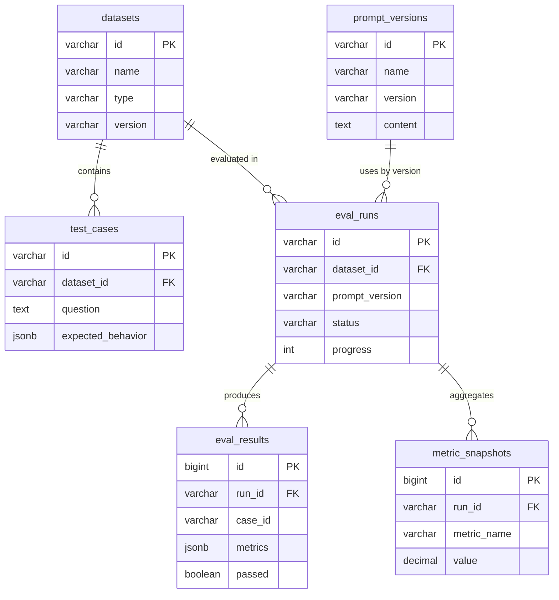
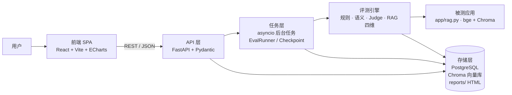
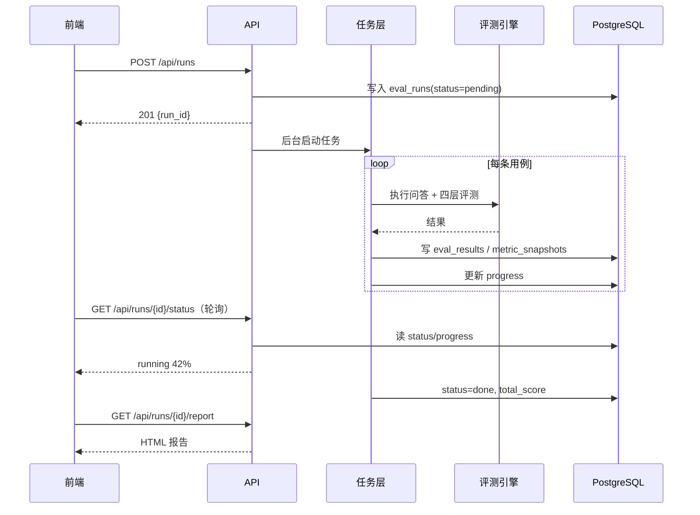

# Day 15：平台架构设计

> 项目三第 3 周 · 地基日：先把实体、关系、接口、表结构钉死，再写代码。

## 一、设计原则

**契约先行。** 前后端按同一份契约并行开发：前端拿契约造 mock 数据，后端按契约实现，联调时字段名和结构不用改。反过来先写代码，后期必然返工。

三条硬约束：

1. 实体只保留业务必需的字段，指标一律进 JSONB（指标还在迭代，不该靠改表来加指标）
2. 所有跨表关系都有外键，评测数据随数据集/任务级联删除，不留孤儿行
3. 接口返回结构统一，错误码统一，前端只需写一套错误处理

## 二、核心实体（6 个）

| 实体 | 说明 | 关键字段 |
|------|------|---------|
| Dataset | 评测数据集 | id, name, type(golden/edge/adversarial), case_count, version |
| TestCase | 单条用例 | id, dataset_id, question, ground_truth, category, expected_behavior |
| PromptVersion | Prompt 版本 | id, name, version, content, created_at |
| EvalRun | 一次评测任务 | id, dataset_id, prompt_version, status, progress, total_score |
| EvalResult | 单条用例结果 | id, run_id, case_id, metrics, answer, contexts, passed |
| MetricSnapshot | 指标快照 | id, run_id, metric_name, value |

几个关键取舍：

- **TestCase.expected_behavior 用 JSONB**：对抗集的断言规则（must_contain_any / must_refuse）与黄金集完全不同，用固定列会迫使空列泛滥
- **EvalRun 存 prompt_version 字符串而非外键 id**：评测结果要能脱离 Prompt 表独立解读；`(name, version)` 唯一键保证仍可关联
- **MetricSnapshot 与 EvalResult.metrics 冗余**：前者让趋势/雷达图直接按 metric_name 聚合，不用扫全量 JSONB。这是有意为之的读优化
- **EvalResult 加 UNIQUE(run_id, case_id)**：断点续跑重放时不产生重复行，天然幂等

## 三、ER 关系



## 四、API 契约（13 个接口）

### 4.1 通用约定

- 基础路径 `/api`，JSON 请求/响应，UTF-8
- 成功：`200`，body 直接是数据对象或 `{items, total, page, page_size}`
- 失败：HTTP 4xx/5xx + `{"code": "RUNNING_CONFLICT", "message": "任务正在运行中"}`
- 分页参数 `page`（从 1 开始）、`page_size`（默认 20，上限 100）
- 时间统一 ISO 8601 字符串

### 4.2 接口表

| # | 方法 | 路径 | 说明 | 请求要点 | 返回 |
|---|------|------|------|---------|------|
| 1 | GET | `/api/datasets` | 数据集列表 | `type` 可选过滤 | 分页列表（含 case_count） |
| 2 | POST | `/api/datasets` | 创建数据集 | name, type, description | 数据集对象 |
| 3 | GET | `/api/datasets/{id}/cases` | 用例列表 | `category` 可选过滤 | 分页列表 |
| 4 | POST | `/api/datasets/upload` | 上传 JSON 数据集 | multipart 文件 | 导入结果（成功/跳过/失败条数） |
| 5 | GET | `/api/prompts` | Prompt 版本列表 | - | 版本列表（按创建时间倒序） |
| 6 | POST | `/api/prompts` | 新建 Prompt 版本 | name, version, content, description | 版本对象（版本号重复返回 409） |
| 7 | POST | `/api/runs` | 发起评测 | dataset_id, prompt_version, model, concurrency | `run_id + status=pending`（立即返回，后台跑） |
| 8 | GET | `/api/runs` | 评测任务列表 | `status` 可选过滤 | 分页列表（含 progress / total_score） |
| 9 | GET | `/api/runs/{id}` | 任务详情 | - | 任务字段 + 指标摘要 |
| 10 | GET | `/api/runs/{id}/results` | 用例结果列表 | `passed` 可选过滤 | 分页列表（不含 contexts 大字段） |
| 11 | GET | `/api/runs/{id}/report` | 获取报告 | `format=html\|json` | HTML 文件或 JSON |
| 12 | GET | `/api/runs/{id}/status` | 轮询任务状态 | - | `{status, progress, processed, total, failed}` |
| 13 | POST | `/api/runs/compare` | 对比两次评测 | run_id_a, run_id_b | 指标 diff + regressions/improvements |

### 4.3 两个关键报文示例

发起评测（#7）——**必须立即返回**，否则前端会等到超时：

```json
POST /api/runs
{ "dataset_id": "ds_golden_v1", "prompt_version": "v1.2.0", "model": "qwen-plus", "concurrency": 5 }

201 Created
{ "run_id": "0f3c...", "status": "pending", "total_cases": 55 }
```

轮询状态（#12）——前端进度条只依赖这一个接口：

```json
GET /api/runs/0f3c.../status
{ "status": "running", "progress": 42, "processed": 23, "total": 55, "failed": 1 }
```

### 4.4 错误码

| HTTP | code | 场景 |
|------|------|------|
| 400 | `INVALID_PARAM` | 参数缺失/格式错误（如 page_size > 100） |
| 404 | `NOT_FOUND` | 数据集 / 任务 / 报告不存在 |
| 409 | `VERSION_CONFLICT` | Prompt 同名版本已存在 |
| 409 | `RUNNING_CONFLICT` | 同一数据集+Prompt 已有运行中任务 |
| 422 | `DATASET_INVALID` | 上传 JSON 缺 question 字段 |
| 500 | `INTERNAL_ERROR` | 未预期异常，message 不含堆栈 |

## 五、完整 Schema

见 [sql/schema.sql](sql/schema.sql)：6 张表 + 唯一约束 + 外键级联 + 6 个索引。

| 表 | 主要约束 | 说明 |
|----|---------|------|
| datasets | `UNIQUE(name, version)` | 同名多版本并存 |
| test_cases | FK → datasets `ON DELETE CASCADE` | 删数据集即删用例 |
| prompt_versions | `UNIQUE(name, version)` | 版本不可覆盖，只能新增 |
| eval_runs | FK → datasets | status 五态：pending/running/done/failed/cancelled |
| eval_results | FK → eval_runs CASCADE，`UNIQUE(run_id, case_id)` | 幂等写入 |
| metric_snapshots | FK → eval_runs CASCADE，`UNIQUE(run_id, metric_name)` | 趋势图直查 |

索引覆盖三类高频查询：按数据集查用例（`idx_cases_dataset`）、按任务查结果与失败项（`idx_results_run` / `idx_results_failed`）、按指标看趋势（`idx_snapshots_metric`）。

## 六、架构图



各层职责：

| 层 | 技术选型 | 核心职责 | 不做什么 |
|----|---------|---------|---------|
| 前端 | React + Vite + ECharts | 数据集管理、发起评测、进度轮询、结果可视化 | 不直接拼 SQL、不算指标 |
| API | FastAPI + Pydantic | 参数校验、契约稳定、错误码统一 | 不执行长任务（会阻塞） |
| 任务层 | asyncio + EvalRunner | 并发/重试/缓存/断点续跑、进度上报 | 不实现具体指标 |
| 引擎 | evaluation/* + analysis/* | 指标计算与归因 | 不关心 HTTP 与存储 |
| 存储 | PostgreSQL + Chroma + 文件 | 结果持久化、向量检索、报告归档 | 不含业务判断 |

## 七、数据流



数据链路：**数据集 → 用例 → 评测任务 → 用例结果 → 指标快照 → 聚合报告**，每一步都有唯一落库点，任何一层出问题都能定位到具体行。

## 八、今日产出对照

| 计划产出 | 交付 |
|---------|------|
| 核心实体 | ✅ 6 个实体 + 字段 + 4 条设计取舍 |
| ER 图 | ✅ Mermaid，6 实体 5 组关系 |
| API 契约 | ✅ 13 个接口 + 通用约定 + 2 个报文示例 + 6 个错误码 |
| 完整 Schema | ✅ 6 表 + 唯一约束 + 级联 + 6 索引 |
| 架构图 | ✅ 分层图 + 时序图 + 各层职责表 |
